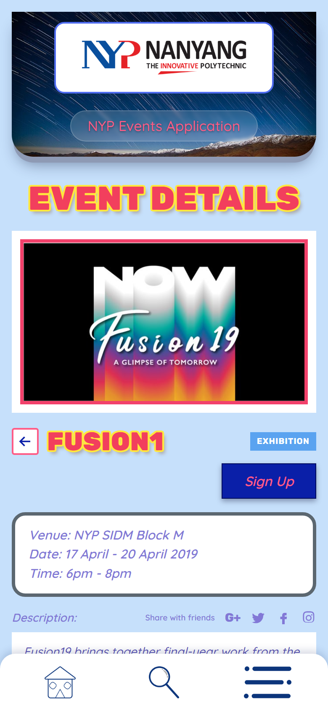
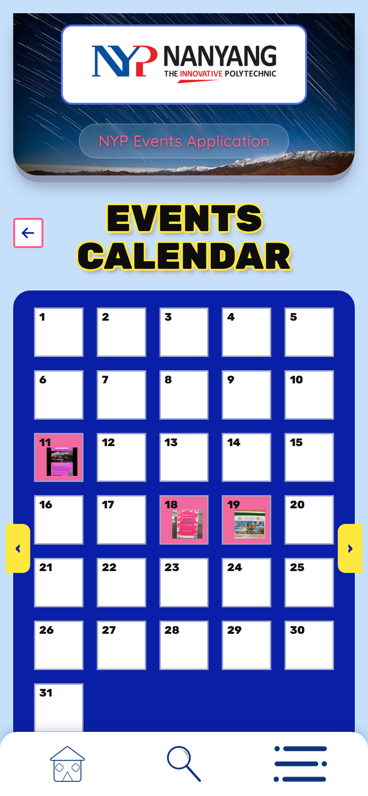

# NYP Mobile Events Manager

A mobile events app for Nanyang Polytechnic students to browse campus events and for organisers to publish new ones. Built as a Final Year Project in 2019 with a **React** frontend, a **Laravel REST API** and a **MySQL** database.

### >>> [Try the live demo](https://pinkaig.github.io/NYP-Mobile-Events-Manager/)

The demo runs the app as designed for the project poster, inside a phone frame in your browser. There's nothing to install.

<p align="center">
  
  &nbsp;&nbsp;
  
  &nbsp;&nbsp;
  
</p>

## Features

- **Events@NYP:** browse campus events as cards, then open one for its venue, dates, time and description
- **Sign up:** register for an event and see your list under *My sign-ups*
- **Events calendar:** a month view with each event's poster on its start day
- **Search:** search by name or venue, and filter by category (Overseas, Camp, CCA, Performance, Exhibition)
- **Host an event:** log in and publish your own event with a poster image
- **Backend:** a Laravel REST API for users, events, categories, registrations and feedback, with token-based register/login endpoints

## Tech stack

| Layer | Technology |
|---|---|
| Frontend | React 16, React Router (HashRouter), Create React App |
| API | Laravel 5.8 (PHP 7), Eloquent ORM, resource routes under `/api` |
| Database | MySQL / MariaDB with 5 tables and foreign keys |

```
React app  ──JSON──▶  Laravel /api/*  ──Eloquent──▶  MySQL
(frontend/)          (backend/routes/api.php)       (database/nyp_db.sql)
```

## Data model


`users` · `categories` · `events` (→ users, categories) · `event__registers` (→ users, events) · `event__feedback` (→ users, events)

## Repository layout

```
frontend/   React app source (src/, public/, package.json)
backend/    Laravel API: app/ models + controllers, routes/api.php, migrations
database/   nyp_db.sql export and database design diagram
docs/       GitHub Pages showcase: index.html (phone frame)
            prototype/  the poster design as a working app (live demo)
            app.html    the original React build with a simulated API
tools/      build-demo.js, which packs the React build into docs/app.html
```

## Run it locally

**Frontend** (Node.js):

```bash
cd frontend
npm install
npm start          # on Node 17+, set NODE_OPTIONS=--openssl-legacy-provider first
```

**Backend** (PHP 7.1–7.4, Composer, MySQL):

```bash
cd backend
composer install
cp .env.example .env      # set DB_DATABASE=nyp_db, DB_USERNAME, DB_PASSWORD
php artisan key:generate
mysql -u root -e "CREATE DATABASE nyp_db"
mysql -u root nyp_db < ../database/nyp_db.sql
php artisan serve
```

The frontend calls `http://nypapp.eventsmgr/api`, which was a local Apache virtual host in 2019. Point it at your API URL, for example `http://127.0.0.1:8000/api`.

## About the live demo

The phone on the showcase runs `docs/prototype/`. It's the app's poster design rebuilt as a working web prototype in plain HTML, CSS and JavaScript. It uses the project's own images and details from the real 2019 event posters. Sign-ups and hosted events are saved in the visitor's browser.

`docs/app.html` is the compiled React app with a small in-browser stand-in for the Laravel API. The stand-in answers the same `/api` routes, starting from the data in `nyp_db.sql`. Changes are saved in the visitor's browser only. To rebuild it:

```bash
cd frontend && npm run build && node ../tools/build-demo.js . ../docs/app.html
```

(Run with `NO_STRIP=1 STANDALONE=1` to match the published file.)

## What I'd improve next

- **Edit screen:** load the selected event and send `PUT /api/events/{id}`. The original sends `PUT /api/events` without an ID.
- **Delete route:** fix the typo in `routes/api.php` (`'events/event_id}'`).
- **Photos:** store uploaded photos on disk so event images display.
- **Config:** move the API base URL into an environment variable and enable CORS.
- **Auth:** turn on the `auth:api` route group so writes require a logged-in user.
